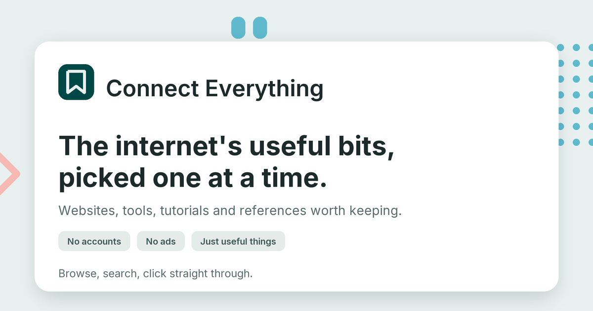

# Connect Everything

**A public, hand-curated toolbox of the useful internet** — websites, tools, tutorials and references worth keeping. Browse, search, filter, and click straight through to the thing you need.

**94 resources · 8 categories · 35 tags · no accounts · no tracking · no ads**



```bash
npm install
npm run dev      # http://localhost:4321
```

---

## Why it exists

The web is full of lists that were generated instead of curated. This is the opposite: a small, deliberate library where everything earned its place, and the only thing a visitor has to do is click.

- **One click out.** The whole card is a link. No detail page, no interstitial, no "read more".
- **No account wall.** Visitors browse freely; there is nothing to sign up for.
- **Nothing is for sale.** No sponsored entries, no affiliate links, no ads.
- **Honest metadata.** No view counters or "trending" numbers, because they cannot be computed honestly without tracking visitors. Featured entries get a small badge instead.

## What's inside

| Category | Entries | What it covers |
|---|---|---|
| Design | 12 | UI tools, type, colour, icons, illustrations |
| Development | 12 | Frameworks, build tools, testing, validation |
| Learning | 12 | Courses, tutorials, practice and communities |
| Tools | 12 | Small utilities that save an afternoon |
| Productivity | 10 | Notes, tasks, planning, time |
| Media | 12 | Images, icons, video, audio, conversion |
| Data & AI | 12 | Models, datasets, research, assistants |
| Reference | 12 | Docs worth keeping one tab away |

Plus **12 featured picks** on [`/featured`](src/pages/featured.astro), and a controlled tag vocabulary of **35 terms** — every one in use, none drifting into synonyms.

## Features

**Browsing**
- Sidebar categories (single-select) and tags (multi-select, **AND** semantics)
- Counts recalculated against your *other* active filters, so you always see what is reachable
- Sort by featured first, newest, or A–Z
- Long tag lists collapse behind "Show all 35 tags" — and render in full without JavaScript

**Search**
- Matches title, domain, description, category and tags
- Multi-word queries are AND (`css grid` → CSS-Tricks, and nothing else)
- Matches highlighted in place; `/` or `⌘K` focuses the field, `Esc` clears it

**Every view is linkable**
- Query, category, tags and sort are mirrored in the URL
- `?q=free&category=learning&tag=Practice&sort=az` restores exactly that view

**Details that matter**
- Tag chips on a card add that tag to your filters
- Kebab menu: open in a new tab, or copy the link
- Works without JavaScript: the grid is server-rendered and every card links out
- Favicon with a deterministic monogram fallback, so a slow or blocked icon never leaves a blank tile

## Routes

| Route | Purpose |
|---|---|
| `/` | The library — all resources, live filtering |
| `/featured` | Curator's picks |
| `/suggest` | How to suggest a resource, via GitHub |
| `/404` | Search, category shortcuts and three picks instead of a dead end |

## Accessibility

- One `h1` per page, landmark structure, skip link, visible focus rings everywhere
- Filters are real toggle buttons with `aria-pressed`; result counts are announced politely
- The mobile filter sheet traps focus, closes on `Escape`/backdrop, and returns focus to its trigger
- Contrast audited: body and meta text clear **AA** on both canvas and card surfaces (`--color-ink-muted` was moved from `#7c8b8a`, which measured 3.55:1, to `#5c6e6c` at 5.38:1)
- All motion respects `prefers-reduced-motion`
- Fully usable with JavaScript disabled — filtering degrades to plain category links

## Tech

**Astro 6** (static output) · **Tailwind CSS 4** · **TypeScript** · self-hosted **Inter**

No client framework, no state library, no database, no backend. The interactive layer is a single 7.7 KB TypeScript module (2.8 KB gzipped) that enhances already-rendered HTML. Requires Node `>= 22.12`.

```
connect-everything/
├── src/
│   ├── data/            # the library — resources, categories, tags
│   ├── components/      # card, sidebar, filters, favicon, brand, ornaments
│   ├── layouts/         # base shell + library layout
│   ├── lib/             # derive (domain/favicon/dates) + build-time validation
│   ├── scripts/         # search, filter, sort engine
│   ├── pages/           # index, featured, suggest, 404
│   └── styles/          # design tokens
├── tests/               # engine tests against the real built HTML
├── scripts/             # link checker, OG image generator
├── docs/PLAN.md         # product + technical plan, milestone by milestone
└── public/              # favicon, robots.txt, OG card
```

## Adding a resource

Everything lives in one file: [`src/data/resources.ts`](src/data/resources.ts). Add an object, run the build, open a pull request.

```ts
{
  id: 'css-tricks',                       // kebab-case, unique
  title: 'CSS-Tricks',
  url: 'https://css-tricks.com',          // https only
  description:
    'A long-running publication about CSS and front-end craft, with the deepest explainers anywhere on layout, grid, and the odd corners of the cascade.',
  category: 'learning',                   // one of 8
  tags: ['CSS', 'Layout', 'Tips'],        // 1–5, from the vocabulary
  featured: true,                         // optional — curator's pick
  dateAdded: '2026-01-12',                // YYYY-MM-DD
}
```

**Derived automatically — never type these:** the domain, the favicon, and every sidebar count.

**Rules, enforced at build time.** `npm run build` fails with a specific message naming the entry and the field, so a malformed resource can never reach the published library.

| Field | Rule |
|---|---|
| `id` | kebab-case, unique |
| `url` | absolute, `https`, no duplicates (`www` and trailing slashes are normalised) |
| `description` | 60–220 characters, written in a human voice |
| `category` | one of the 8 in `src/data/categories.ts` |
| `tags` | 1–5, each already in `src/data/tags.ts` |
| `dateAdded` | `YYYY-MM-DD`, not in the future |

Descriptions in the current library run 98–168 characters (mean 143). Adding a *tag* means adding one line to [`src/data/tags.ts`](src/data/tags.ts) first — the controlled vocabulary is what stops the sidebar fragmenting into `js` / `javascript` / `JavaScript`.

**What gets in:** still online and maintained · free, or worth the price · useful before you sign up · something a person would genuinely return to.

## Scripts

| Command | What it does |
|---|---|
| `npm run dev` | Dev server on `:4321` |
| `npm run build` | Static build to `dist/`, validating every entry |
| `npm run preview` | Serve the production build locally |
| `npm test` | Build, then run both test suites against the real HTML |
| `npm run check` | Type-check `.astro` and `.ts` files |
| `npm run links` | Sweep every resource URL for dead links (needs real internet) |
| `npm run og` | Regenerate the OG card (needs `pillow`, `fonttools`, `brotli`) |

## Testing

`npm test` builds the site, then drives the real engine module against the real built HTML in jsdom — not a mocked DOM.

- **34 assertions** on the library page: search (single and multi-term AND, highlighting), category and tag filtering, post-filter counts, ARIA state, URL sync, all three sorts, empty state, clearing, card chips, and menu behaviour.
- **8 assertions** in a separate process: a shared link restores query, category, tag and sort, every visible card genuinely matches, and the URL is left untouched on load.

Expectations are derived from the page's own data attributes rather than hardcoded counts, so growing the library never breaks the suite. Every resource is server-rendered before JavaScript runs, so a broken script degrades to a plain, fully linked list rather than a blank page.

## Performance

Measured on the 94-entry build:

| Asset | Gzipped |
|---|---|
| HTML (`/`) | 36.9 KB |
| CSS | 6.9 KB |
| JS | 2.8 KB |

Favicons are the only third-party request per card: lazy-loaded in a fixed-size box, so they cannot shift layout.

**Not yet measured:** Lighthouse and 200% zoom, because this environment has no browser. Both are one-command checks on a real machine — see *Known gaps* below.

## Deployment

Static output: any host that serves files. On Vercel, Astro is detected automatically — build `npm run build`, output `dist`. No environment variables, secrets, database or server functions.

**Before launch**

1. Replace the placeholder `site` in [`astro.config.mjs`](astro.config.mjs) (`https://connecteverything.example`) with the real domain, and update the sitemap URL in [`public/robots.txt`](public/robots.txt). Canonical URLs, OG tags and the sitemap all derive from it.
2. Run `npm run links` from a machine with open internet to confirm no entry has died since it was added.
3. Add a `LICENSE` — see below.

## Known gaps

- **Lighthouse / 200% zoom** unverified (no browser in the environment that built this).
- **Dead-link sweep** not yet run against the live web; the tool is written, the environment is not allowed to reach those hosts.
- **Project name** is still a placeholder from the planning stage (`docs/PLAN.md` §11).

## Contributing

Suggestions go through GitHub, as described on the site's `/suggest` page:

- **Quick:** [open an issue](https://github.com/mafk21/connect-everything/issues/new) with a link and a line on why it belongs.
- **Hands-on:** edit [`src/data/resources.ts`](src/data/resources.ts) and open a pull request.

Everything is reviewed by the curator before it appears — nothing is published automatically.

## License

Not yet specified.
